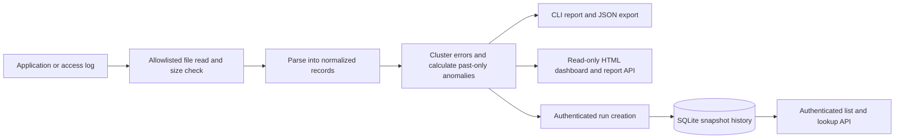

# Log Analyzer — Application Log Triage Tool

A local incident-triage service that parses application logs, clusters errors by
endpoint, detects anomalies (traffic spikes, error-count spikes, repeated
timeouts), and surfaces reports through a CLI, browser dashboard, and JSON API.
Optional SQLite snapshots let a team keep a repeatable history of analyses.

Built to mirror the kind of triage work a support/CX engineer does day to day:
a customer reports something broke → pull the logs → find the pattern →
investigate the cause → confirm the fix.

## Why

Most "log analyzer" toy projects just grep for the word ERROR. This one
instead:
- **Clusters** errors by normalized endpoint and exception type
  (`500 /api/orders/{id} [KeyError]` instead of 40 separate lines for 40
  order IDs), so recurring symptoms appear together without mixing different
  exception classes on the same endpoint.
- **Detects anomalies statistically** — traffic and error counts are compared
  with up to 20 earlier observed time buckets. The current bucket never
  influences its own baseline.
- **Flags repeated timeouts** on a specific endpoint even when they're spread
  out over time and wouldn't show up as a "spike."

## Demo

Sample logs (`sample_logs/app.log`) simulate a realistic 45-minute incident
window: normal traffic, a payment-gateway timeout incident, a bad deploy that
causes a `KeyError` on one endpoint, and a traffic spike. Running the tool
against it correctly identifies all three injected incidents (see
[Example Output](#example-output) below).

### CLI

```bash
pip install -r requirements.txt
python scripts/generate_sample_logs.py        # (re)generate sample_logs/app.log
python -m log_analyzer.cli sample_logs/app.log
# or, after installing: log-analyser sample_logs/app.log
```

Use `--bucket-seconds N` to change the anomaly window; `N` must be a positive
integer. Invalid values produce a clear command-line error.

Use Python 3.10 or newer. The editable install exposes the `log-analyser`
command and keeps local code changes immediately testable.

### Web dashboard

```bash
uvicorn log_analyzer.dashboard:app --reload
# open http://127.0.0.1:8000
```

By default the web app can read only files in `sample_logs/`. For another directory,
set `LOG_ANALYZER_ALLOWED_DIR` before starting the server:

```bash
LOG_ANALYZER_ALLOWED_DIR=/path/to/logs uvicorn log_analyzer.dashboard:app --reload
# open http://127.0.0.1:8000/?path=/path/to/logs/app.log
```

The dashboard and `/api/report` reject paths outside that directory, including
symlinks to outside files. Log content is escaped before display in HTML. Keep the
server local or place it behind your own authentication and network controls.

The web app accepts files up to 50 MiB by default. Set `LOG_ANALYZER_MAX_BYTES`
to change that limit. The limit applies to web requests; the CLI can analyze
larger files on a trusted machine.

### Container demo

```bash
export LOG_ANALYZER_API_KEY="$(openssl rand -hex 24)"
docker compose up --build
# open http://127.0.0.1:8000
```

The container runs as a non-root user with a read-only application filesystem.
Compose mounts `sample_logs/` read-only and stores SQLite history in a named
volume. The port binds to localhost. `/health` is available for liveness checks.
Docker is optional; the Python commands above run the same analysis locally.

### Repeatable incident history

Save an analysis locally with `log-analyser sample_logs/app.log --save`.
The tool writes `log_analyzer.db` in the current directory by default; set
`LOG_ANALYZER_DB_PATH` to select another location. A retry with identical
source name and report content returns the same run ID. The database stores
report summaries and sample error messages, not a copy of every log line.

To create and retrieve runs over HTTP, set an API key before starting the server:

```bash
export LOG_ANALYZER_API_KEY="$(openssl rand -hex 24)"
uvicorn log_analyzer.dashboard:app --host 127.0.0.1 --port 8000

curl -X POST -H "X-API-Key: $LOG_ANALYZER_API_KEY" \
  'http://127.0.0.1:8000/api/runs'
curl -H "X-API-Key: $LOG_ANALYZER_API_KEY" \
  'http://127.0.0.1:8000/api/runs?limit=20'
```

`POST /api/runs` accepts an optional `path` query parameter within the allowed
directory. `GET /api/runs/{id}` retrieves a saved report. All run-history
endpoints require the key; without it they return 503. The browser dashboard
and live `/api/report` endpoint remain read-only and are meant for local use.
For a shared deployment, add identity-aware access control, TLS, and log
redaction at the network boundary. Restrict access to the SQLite database,
which contains error excerpts that may include sensitive data.

### JSON output (for piping into other tools)

```bash
python -m log_analyzer.cli sample_logs/app.log --json report.json
```

## Example Output

Selected lines from the sample report (additional minute-level anomalies and
slow endpoints are omitted):

```
Log Analyzer Report — sample_logs/app.log
============================================================
Total lines parsed : 446
Total errors       : 46
Error rate         : 10.31%

Top Error Clusters
------------------------------------------------------------
  [40x] 500 /api/orders/{id} [KeyError]
        sample: KeyError: 'discount_code' not found in response payload
        first: 2026-07-04 09:31:00   last: 2026-07-04 09:34:00
  [6x] 504 /api/payments/charge [TimeoutError]
        sample: TimeoutError: upstream payment gateway did not respond
        first: 2026-07-04 09:25:00   last: 2026-07-04 09:30:00

Anomalies Detected
------------------------------------------------------------
  [HIGH] repeated_timeout: /api/payments/charge timed out 6 times
        window: 2026-07-04 09:25:00 → 2026-07-04 09:30:00
  [HIGH] error_count_spike: 10 errors vs prior avg 0.3
        window: 2026-07-04 09:31:00 → 2026-07-04 09:32:00
  ...
  [MEDIUM] traffic_spike: 40 requests vs prior avg 7.7
        window: 2026-07-04 09:35:00 → 2026-07-04 09:36:00
  ...

Slowest Endpoints (by avg response time)
------------------------------------------------------------
  /api/payments/charge           avg   390.5ms   max   3439ms   n=66
```

Reading that output top to bottom tells the same story a support engineer
would need to reconstruct by hand: the payment gateway started timing out
around 09:25, which was likely still being investigated when a deploy at
09:31 introduced a `KeyError` on the orders endpoint, and a traffic spike hit
five minutes later on top of it.

## How it works



The CLI and web service share the same parser and analyzer. The web service
enforces the configured log directory and size limit before analysis. Saved
runs are keyed by source name and report content so a retry is idempotent.

- **`log_analyzer/parser.py`** — regex-based parsers for a structured app-log
  format, Nginx/Apache combined logs, and JSON lines. JSON lines accept
  `timestamp` or `time`, `endpoint` or `path`, and `status` or `status_code`.
  Offset-aware timestamps are normalized to UTC; timestamps without an offset
  are treated as UTC. All formats return normalized `LogRecord` objects.
- **`log_analyzer/analyzer.py`** — clustering (via normalized endpoint
  signatures), past-only time-bucketed spike detection (mean + N·stddev), and
  repeated-timeout detection across the whole file regardless of bucket.
- **`log_analyzer/cli.py`** — argparse CLI, human-readable report + optional
  JSON export.
- **`log_analyzer/dashboard.py`** — FastAPI app rendering the same report as
  an HTML dashboard, plus a `/api/report` JSON endpoint and authenticated
  run-history endpoints.
- **`log_analyzer/store.py`** — SQLite snapshots with stable IDs and
  bounded history queries, so repeated analyses do not duplicate records.
- **`scripts/generate_sample_logs.py`** — generates the synthetic log file
  used for the demo/tests, with three deliberately injected incidents.

## Testing

```bash
pip install -r requirements.txt
pytest tests/ -v
```

25 tests cover log parsing, analysis, input validation, dashboard HTML escaping, path isolation,
file-size limits, authenticated API access, and idempotent persistence. GitHub
Actions runs lint and tests on Python 3.10 and 3.13 for every push and pull request.

## Possible extensions

- Slack/email alerting when a `HIGH` severity anomaly is detected
- Rolling live-tail mode instead of static-file analysis

## Operating limits

This is a local or single-node incident-triage tool. The anomaly score is a
simple historical baseline, not a trained model or causal diagnosis. Idle
minutes with no log records are not included in the baseline. SQLite suits
one service instance but does not provide distributed ingestion, multi-user
roles, retention policies, or automatic secret redaction. Use a managed log
platform and identity provider for those needs.

## Stack

Python 3.10+ · FastAPI · SQLite · regex-based log parsing · pytest · Ruff
